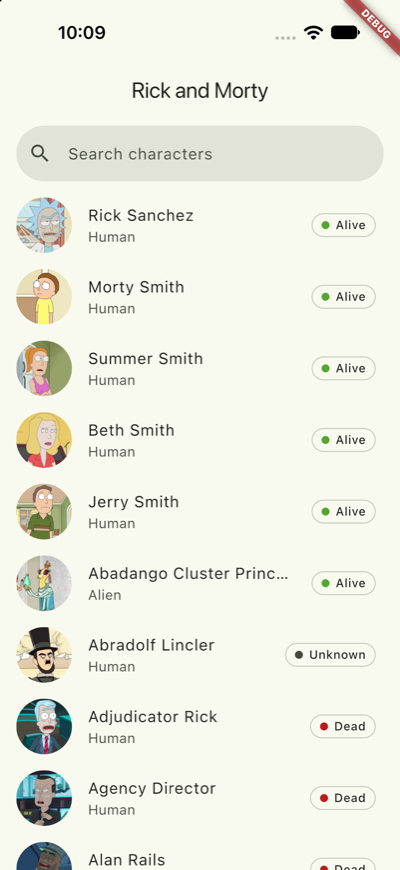
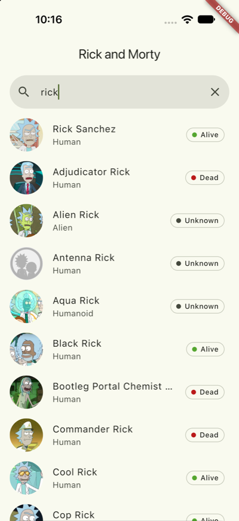
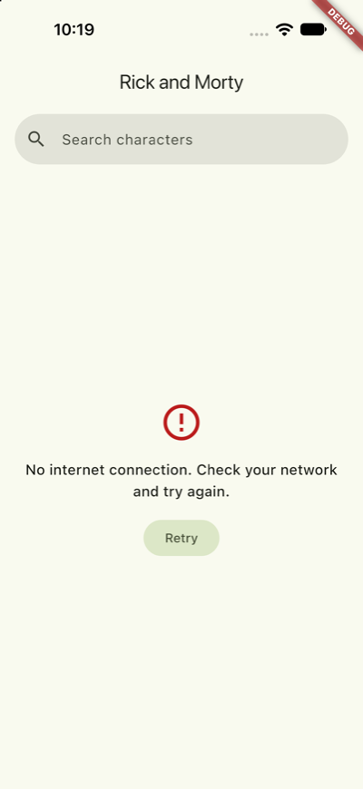
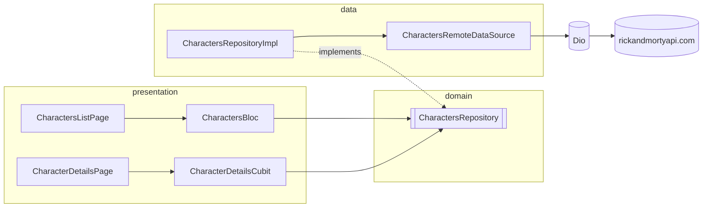

# Rick and Morty Character Catalog

English | [Русский](README.ru.md)

[](https://github.com/NikitaDemedyuk/rickandmorty-flutter/actions/workflows/ci.yaml)

A Flutter client for the [Rick and Morty API](https://rickandmortyapi.com): a paginated, searchable character list and a details screen.

| List | Search | Details | Error |
| ---- | ------ | ------- | ----- |
|  |  |  |  |


## Features

- **Infinite scroll** over every character in the API, 20 per page, with pull-to-refresh.
- **Search by name**, debounced (400 ms); a newer query cancels the request of an older one.
- **Every list state has its own UI:** first-page loader, error with retry, empty results, next-page loader, next-page error with retry, end of list.
- **Details screen** with a `Hero` portrait, status, species, origin and last known location. It fetches by id, so deep links (`/character/42`) work too.
- **Round trip without a refetch:** coming back from details keeps the query, the loaded pages and the scroll position.
- **Distinct error messages** for offline, timeout, rate limiting (HTTP 429), server errors and unknown ids.
- English only, since that is the show's language (copy still goes through gen-l10n).

## Getting started

The Flutter SDK is pinned with [fvm](https://fvm.app) (see `.fvmrc`). Generated code is committed, so no `build_runner` step is needed to run the app.

```bash
fvm install
fvm flutter pub get
fvm flutter run
```

## Development

```bash
fvm flutter gen-l10n               # after editing lib/l10n/app_en.arb
fvm dart run build_runner build    # after editing a freezed / json_serializable class
fvm dart run tool/generate_app_icons.dart  # after editing a source in assets/icon/
fvm dart run flutter_native_splash:create  # after editing flutter_native_splash.yaml
fvm dart format .
fvm flutter analyze --fatal-infos
fvm flutter test --coverage
```

CI runs the same checks on every pull request and fails if generated code, localizations, app icons or splash files are stale.

## Architecture

Feature-first, with `domain` / `data` / `presentation` layers inside each feature. `core/` holds what features share and `app/` wires everything together.



```
lib/
  app/        composition root (get_it), go_router, theme
  core/       Failure + its l10n message, Result, Dio client + error mapper, StatusColors theme extension, shared state views
  features/characters/
    domain/        entities, repository contract
    data/          DTOs, mappers, remote data source, repository impl
    presentation/  list (Bloc), details (Cubit), shared widgets
  l10n/       app_en.arb + generated localizations
```

- **Errors are values.** The repository returns a sealed `Result<T>` (`Ok` / `Err`) holding a domain `Failure`. Blocs keep the `Failure`, and the UI maps it to a localized message.
- **One source of truth for paging.** `CharactersBloc` owns the `PagingState` and `PagedListView` only renders it.
- **Routes carry ids, not entities.** Details fetch by id. The list hands over only the portrait URL, so the `Hero` has something to fly while the character loads.
- **`GetIt` stays at the edges.** It is used in `app/di.dart` and the route builders only, never inside widgets or blocs.

### Stack

| Package | Why |
| ------- | --- |
| `flutter_bloc` + `bloc_concurrency` | A Bloc for the list (debounce + restartable search, droppable next page), a Cubit for the single-load details screen. |
| `infinite_scroll_pagination` v5 | Controller-less mode: the Bloc's `PagingState` drives the list. |
| `dio` | Timeouts, cancellation, logging, and typed `DioException` → `Failure` mapping. |
| `freezed` + `json_serializable` | DTOs, states and `copyWith`. Malformed JSON fails as a `CheckedFromJsonException`. |
| `go_router` | Path-based routes (`/`, `/character/:id`) for deep links. |
| `get_it` | One hand-written composition root; `injectable` buys nothing for a handful of registrations. |
| `cached_network_image` | The list and details share one cached decode, so the `Hero` flies the real image. |
| `material_ui` | The decoupled Material library. |
| `mocktail`, `fake_async` | Mocks and deterministic time for the debounce and cancellation tests. |

## Workflow

- `main` holds releases only; every merge into it is tagged.
- `develop` is the integration branch and the default branch.
- Feature branches (`feat/…`, `chore/…`, `fix/…`, `docs/…`) are cut from `develop` and squash-merged back through a pull request.
- Commits follow [Conventional Commits](https://www.conventionalcommits.org). Changes are listed in [CHANGELOG.md](CHANGELOG.md).
