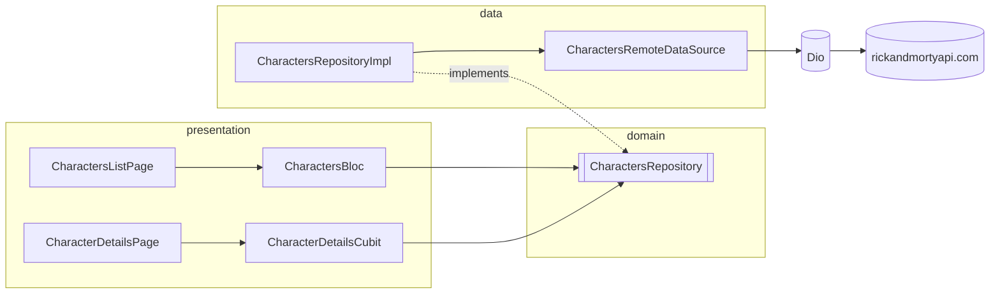

# Rick and Morty Character Catalog

[English](README.md) | Русский

[](https://github.com/NikitaDemedyuk/rickandmorty-flutter/actions/workflows/ci.yaml)

Flutter-клиент для [Rick and Morty API](https://rickandmortyapi.com): постраничный список персонажей с поиском и экран с подробностями.

## Возможности

- **Бесконечная прокрутка** по всем персонажам API, по 20 на страницу, с pull-to-refresh.
- **Поиск по имени** с debounce (400 мс); новый запрос отменяет запрос предыдущего.
- **У каждого состояния списка свой UI:** загрузка первой страницы, ошибка с повтором, пустой результат, загрузка следующей страницы, ошибка следующей страницы с повтором, конец списка.
- **Экран подробностей** с `Hero`-портретом, статусом, видом, происхождением и последним известным местоположением. Данные загружаются по id, поэтому работают и deep links (`/character/42`).
- **Возврат без повторной загрузки:** после экрана подробностей сохраняются запрос, загруженные страницы и позиция прокрутки.
- **Отдельные сообщения об ошибках** для отсутствия сети, таймаута, ограничения частоты запросов (HTTP 429), ошибок сервера и несуществующих id.
- Интерфейс приложения только на английском, языке сериала (тексты всё равно проходят через gen-l10n).

## Начало работы

Версия Flutter SDK закреплена через [fvm](https://fvm.app) (см. `.fvmrc`). Сгенерированный код хранится в репозитории, поэтому для запуска приложения `build_runner` не нужен.

```bash
fvm install
fvm flutter pub get
fvm flutter run
```

## Разработка

```bash
fvm flutter gen-l10n               # после правки lib/l10n/app_en.arb
fvm dart run build_runner build    # после правки класса freezed / json_serializable
fvm dart run tool/generate_app_icons.dart  # после правки исходника в assets/icon/
fvm dart run flutter_native_splash:create  # после правки flutter_native_splash.yaml
fvm dart format .
fvm flutter analyze --fatal-infos
fvm flutter test --coverage
```

CI выполняет те же проверки в каждом pull request и падает, если сгенерированный код, локализации, иконки приложения или файлы splash-экрана устарели.

## Архитектура

Feature-first: внутри каждой фичи слои `domain` / `data` / `presentation`. В `core/` лежит то, что фичи используют совместно, а `app/` связывает всё вместе.



```
lib/
  app/        composition root (get_it), go_router, тема
  core/       Failure + его l10n-сообщение, Result, Dio-клиент + маппер ошибок, расширение темы StatusColors, общие экраны состояний
  features/characters/
    domain/        сущности, контракт репозитория
    data/          DTO, мапперы, удалённый источник данных, реализация репозитория
    presentation/  список (Bloc), подробности (Cubit), общие виджеты
  l10n/       app_en.arb + сгенерированные локализации
```

- **Ошибки — это значения.** Репозиторий возвращает sealed `Result<T>` (`Ok` / `Err`) с доменным `Failure`. Блоки хранят `Failure`, а UI превращает его в локализованное сообщение.
- **Один источник истины для пагинации.** `PagingState` принадлежит `CharactersBloc`, а `PagedListView` только отображает его.
- **Маршруты передают id, а не сущности.** Экран подробностей загружает персонажа по id. Список передаёт только URL портрета, чтобы `Hero` было что анимировать, пока персонаж загружается.
- **`GetIt` только на краях.** Он используется только в `app/di.dart` и в построителях маршрутов, никогда внутри виджетов или блоков.

### Стек

| Пакет | Зачем |
| ----- | ----- |
| `flutter_bloc` + `bloc_concurrency` | Bloc для списка (debounce + restartable для поиска, droppable для следующей страницы), Cubit для экрана подробностей с одной загрузкой. |
| `infinite_scroll_pagination` v5 | Режим без контроллера: списком управляет `PagingState` блока. |
| `dio` | Таймауты, отмена запросов, логирование и типизированное преобразование `DioException` → `Failure`. |
| `freezed` + `json_serializable` | DTO, состояния и `copyWith`. Некорректный JSON падает с `CheckedFromJsonException`. |
| `go_router` | Маршруты по путям (`/`, `/character/:id`) для deep links. |
| `get_it` | Один composition root, написанный вручную; `injectable` ничего не даёт при паре регистраций. |
| `cached_network_image` | Список и подробности используют одно закэшированное декодированное изображение, поэтому `Hero` анимирует настоящую картинку. |
| `material_ui` | Отделённая от фреймворка библиотека Material. |
| `mocktail`, `fake_async` | Моки и детерминированное время для тестов debounce и отмены. |

## Процесс

- `main` содержит только релизы; каждый merge в него помечается тегом.
- `develop` — интеграционная ветка и ветка по умолчанию.
- Ветки фич (`feat/…`, `chore/…`, `fix/…`, `docs/…`) создаются от `develop` и возвращаются в неё через pull request со squash merge.
- Коммиты следуют [Conventional Commits](https://www.conventionalcommits.org). Изменения перечислены в [CHANGELOG.md](CHANGELOG.md) (на английском).
